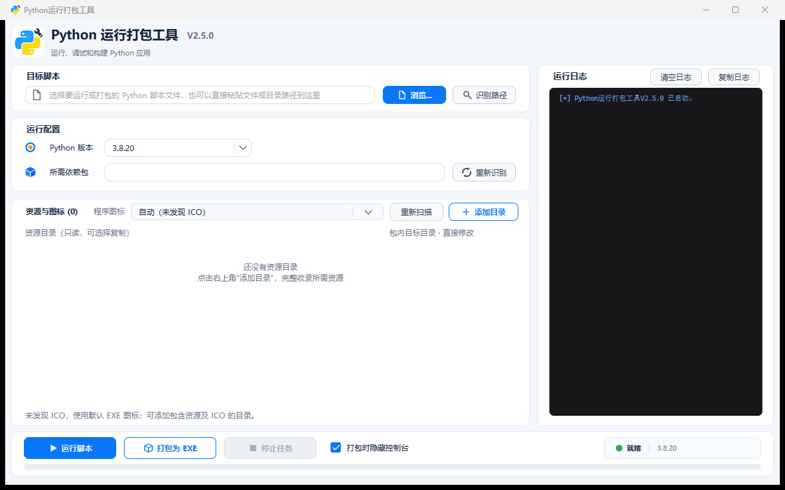

# Python运行打包工具（Python Tool）


基于 Tkinter 和 [uv](https://docs.astral.sh/uv/) 的 Python 脚本运行与 EXE 打包工具，支持依赖识别、Python 版本选择和资源目录打包。

## 软件界面



左侧配置目标脚本、依赖和资源，右侧查看日志，底部运行、打包或停止任务。

## 功能特性

- **脚本选择**：支持浏览文件、粘贴文件或目录路径；自动识别常见入口脚本，多个候选脚本可从列表选择。
- **依赖识别**：自动识别第三方依赖，过滤标准库和本地模块，并将常见模块名转换为安装包名，例如 `serial → pyserial`、`PIL → Pillow`；支持手动修改。
- **Python 版本选择**：支持选择 Python 3.8.20 至 3.13，默认使用 3.8.20。
- **隔离运行**：通过 uv 管理 Python 环境和依赖，无需手动创建虚拟环境。
- **EXE 打包**：生成单文件 EXE，可选择是否隐藏控制台窗口。
- **资源与图标**：递归收录图片、配置、字体等资源目录，支持编辑包内路径，并设置 EXE 和 Tkinter 默认窗口图标。
- **日志与任务控制**：实时显示运行和打包输出，支持复制、清空日志和停止任务；Windows 下停止任务时同时结束相关子进程。
- **界面缩放**：支持窗口缩放和高 DPI 显示，资源较多时可在列表内滚动查看。
- **构建清理**：打包成功后清理当前脚本对应的中间文件，保留最终 EXE 和用户源资源。

## 环境要求

- 使用本工具前，需要安装 [uv](https://docs.astral.sh/uv/) 并将其加入系统 PATH。
- 源码运行还需要 Python 3.8 或更高版本，以及可用的 Tkinter；无需额外安装 GUI 依赖包。

Windows 下可在 PowerShell 中安装 uv：

```powershell
powershell -ExecutionPolicy ByPass -c "irm https://astral.sh/uv/install.ps1 | iex"
```

安装后执行 `uv --version` 检查是否可用。其他系统的安装方式见 [uv 官方安装文档](https://docs.astral.sh/uv/getting-started/installation/)。

## 快速开始

### 下载 EXE

从 [Releases](../../releases) 页面下载 EXE，安装 uv 后双击运行。

### 源码运行

在项目目录执行：

```bash
python Python_Tool_main.py
```

## 使用说明

1. 点击 **浏览...** 选择 Python 脚本，或粘贴文件、目录路径后点击 **识别路径**。输入目录时只搜索当前层级，优先选择 `main.py` 或唯一的 main 相关脚本，其余情况从列表中选择。
2. 选择 Python 版本并核对 **所需依赖包**。依赖支持空格、逗号或分号分隔；点击 **重新识别** 可重新分析。
3. 如需资源文件，在 **资源与图标** 中点击 **添加目录**，选择资源目录并核对每行的 **包内目标目录**。点击右侧 **×** 可移除条目。
4. 在 **程序图标** 中选择图标，并按需勾选 **打包时隐藏控制台**。
5. 点击 **运行脚本** 运行源码，或点击 **打包为 EXE** 开始构建。EXE 输出到目标脚本同目录下的 `dist` 文件夹；日志会显示资源映射、构建进度和错误信息。

资源列表只保留在当前会话中。添加或识别脚本不会自动运行程序；任务执行期间无法修改资源配置。

## 资源目录与包内路径

资源以目录为单位添加，目录中的文件会递归收录并保留内部层级。工具只收录明确添加的目录，不会自动添加整个项目。

### 默认目标目录

包内目标目录是所选目录内容在包内的位置，不包含文件名。假设入口脚本是 `D:/项目/main.py`：

| 选择的源目录 | 默认包内目标目录 | 包内资源路径示例 |
| --- | --- | --- |
| `D:/项目` | `.`，显示为“包内根目录（.）” | `doc/ico/app.ico` |
| `D:/项目/doc` | `doc` | `doc/ico/app.ico`、`doc/logo/logo.png` |
| `D:/项目/doc/ico` | `doc/ico` | `doc/ico/app.ico` |
| `D:/共享/fonts` | `fonts` | `fonts/example.ttf` |

选择入口脚本所在目录本身时，内容直接放在包内根目录，不会再套一层项目目录名。根目录显示为 **包内根目录（.）**，点击后可编辑路径。

项目内目录默认使用相对于入口脚本的路径，外部目录默认使用目录名称。先添加资源、后选择脚本时，未手动修改过的默认目标目录会在打包前重新计算。

### 路径要求

- 支持中文和空格路径。
- 目标目录必须是相对路径，允许 `.`；不允许绝对路径、盘符路径、`..` 或 Windows 不支持的名称。
- 重复映射会去重。不同资源指向同一个包内文件或文件与目录重名时，会提示冲突并阻止打包。启用窗口图标同步时，保留文件名 `python_tool_window_icon.ico` 也不能被其他资源占用。
- 不支持含分号的源路径、符号链接或嵌套联接目录。空目录不保证保留。
- 构建期间请勿移动、删除或修改源资源。

### 程序如何读取资源

**收录资源可以解决文件缺失，但不能自动修正目标代码中的硬编码绝对路径。** 程序需要按包内路径查找资源，例如：

```python
import sys
from pathlib import Path

resource_root = Path(getattr(sys, "_MEIPASS", Path(__file__).resolve().parent))
icon_path = resource_root / "doc" / "ico" / "app.ico"
logo_path = resource_root / "doc" / "logo" / "logo.png"
```

工具不会自动修改目标代码，也不会自动收录所选目录以外的资源。

## 程序图标

工具会扫描所选资源目录中的 ICO：

- 只有一个 ICO 时，自动用于 EXE 文件图标和 Tkinter 默认窗口图标。
- 有多个 ICO 时，需要选择其中一个，或选择 **不设置 EXE 图标**。
- 没有 ICO，或选择不设置图标时，使用默认 EXE 文件图标。

目录内容变化后，可点击 **重新扫描**。资源目录中的原始图标仍按配置的包内路径收录。

EXE 文件图标和程序窗口图标可能来自不同设置。目标程序自行调用 `iconbitmap` 或 `iconphoto` 时，以目标程序的设置为准；**不设置 EXE 图标**不会阻止目标程序加载自己的窗口图标。所选图标仅用于被打包的程序，不会改变打包工具自身的图标。

V2.0.1 起支持 Windows 10 下的 Tkinter 窗口图标同步。已经生成的 EXE 需要重新打包后，才会应用新的图标设置。

## 资源过滤与构建清理

收录目录时，会跳过 `__pycache__`、`.git`、`.hg`、`.svn`、`.venv`、`.pytest_cache`、`.mypy_cache` 以及 `.pyc`、`.pyo` 文件。选择项目根目录或其上级目录时，还会排除当前项目的 `build`、`dist` 和入口脚本对应的 `.spec`，避免收录旧构建产物。普通资源子目录不受同名项目输出目录规则影响，例如 `doc/build/guide.txt` 仍会收录。

打包成功后，只清理当前脚本对应的 `build/<脚本名>`、空的 `build` 根目录和 `.spec`。若明确选择了这些路径中的资源，相关路径会保留并在日志中说明。`dist`、最终 EXE 和用户源文件不会被删除。

资源过滤可能需要额外临时磁盘空间。临时资源在构建完成、失败或通过 **停止任务** 结束后清理。请选择具体的资源目录，避免选择包含工具临时目录的过大目录。

## 注意事项

- **控制台程序**：需要命令行窗口时，请取消勾选 **打包时隐藏控制台**。
- **工作目录**：源码运行和构建以入口脚本所在目录作为工作目录。EXE 在其他位置启动时，资源查找仍取决于目标程序的代码。
- **图标有效性**：所选 ICO 缺失或路径无效时会阻止打包；损坏的 ICO 仍可能导致构建失败。
- **输出编码**：日志兼容 UTF-8、GB18030 和 GBK 输出。

## 更多信息

- [更新日志](CHANGELOG.md)
- [开发与测试说明](docs/DEVELOPMENT.md)
